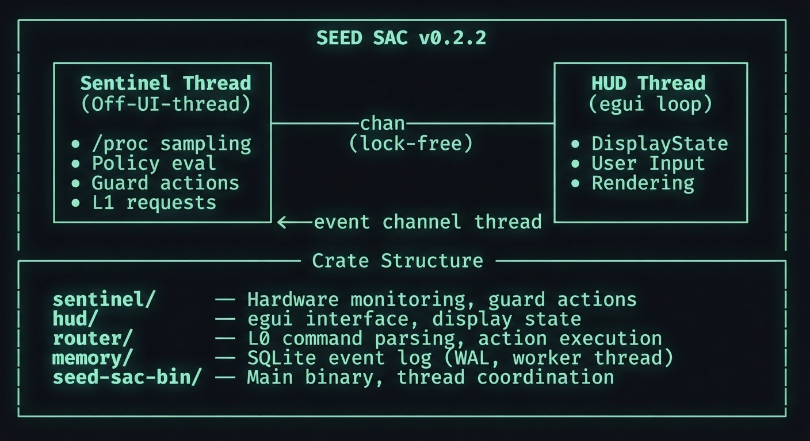

<p align="center">
  
</p>

# SEED SAC — System-Aware Copilot

<p align="center"><strong>Linux resource monitoring and process protection in a lightweight desktop app.</strong></p>

**Status**: Alpha — Stage 2 in progress (Cargo package version `0.2.2`).

SEED SAC is a Rust/Linux system monitor and workload guard. It tracks CPU, RAM, and VRAM pressure, then can freeze a selected runaway process with `SIGSTOP` and identity-bound `pidfd` signaling to help prevent out-of-memory (OOM) crashes. Optional L1 analysis connects to a local OpenAI-compatible language model.

## Features

### Hardware Sentinel (Real-Time Monitoring)
- **CPU, RAM, VRAM tracking** — Continuous sampling via `/proc` and AMD sysfs
- **3-state policy** — Green (normal) → Yellow (warning) → Red (critical)
- **Intelligent freezing** — On Red state, SAC freezes the fastest-growing process via `SIGSTOP` rather than killing it, preserving unsaved work
- **Per-process memory delta** — Detects runaway allocators within milliseconds

### Interactive HUD
- **egui-based GUI** — Always-on-top status bar with minimal footprint
- **Real-time commands** — Kill, resume, or drop caches with two-step confirmation
- **System state visualization** — Visual indicators for CPU/RAM/VRAM pressure
- **L1 LLM integration** — Send system analysis queries to a local language model

### L0/L1 Router
- **Deterministic command grammar** — Parse user intent from free-form text
- **Identity-bound actions** — Verify process identity before signaling (prevents PID reuse attacks)
- **Immune process list** — Protect systemd, display servers, and other critical processes
- **Thaw-on-Exit** — Automatically resume frozen processes if the app crashes or closes

### Safety Hardening
- **pidfd identity binding** — Fail-closed process signal delivery (not SIGKILL-vulnerable)
- **Two-step destructive confirmation** — Kill and drop-caches require explicit user confirmation with 30-second timeout
- **DLP filtering** — Planned for Stage 2; not yet enforced before L1 context upload
- **Zero UI thread blocking** — All disk I/O and system calls happen off-thread via async channels

## Quick Start

### Requirements
- Linux kernel 5.4+ (pidfd support)
- Rust 1.70+
- X11 or Wayland
- Optional: LM Studio (for L1 integration)

### Installation from Source

```bash
git clone https://github.com/jarohull-ai/SEED-SAC.git
cd SEED-SAC
cargo build --release
./target/release/seed-sac-bin
```

### Configuration

Copy the example configuration:
```bash
cp config.example.toml config/default.toml
```

Edit `config/default.toml` to adjust:
- Polling interval (default: 250ms)
- RAM/CPU/VRAM thresholds
- Immune process list
- L1 provider (LM Studio URL, model name)

### Running with LM Studio

1. Install [LM Studio](https://lmstudio.ai/)
2. Load a small model (e.g., Ling-3.0-tiny, Phi-2)
3. Start the server on `http://127.0.0.1:1234`
4. Enable `l1_provider.enabled = true` in config
5. Launch SAC

## Architecture



## Crate Organization

| Crate | Purpose |
|-------|---------|
| `sentinel` | CPU/RAM/VRAM sampling, process identity tracking, guard logic (freeze/kill/thaw), pidfd signal delivery |
| `hud` | egui interface, display state management, user action capture |
| `router` | L0 command grammar, action parsing, executor coordination |
| `memory` | SQLite event log using a dedicated writer thread and WAL |
| `seed-sac-bin` | Main binary: thread setup, channel routing, L1 client coordination |

## Stage 1 & 1.5: Complete ✅

- [x] Hardware Sentinel with 3-state policy
- [x] egui HUD with command input
- [x] L0 deterministic router
- [x] L1 OpenAI-compatible client (off-UI-thread)
- [x] Process identity validation (pidfd on Linux, fallback on non-Linux)
- [x] Two-step destructive confirmation
- [x] Thaw-on-Exit safety guarantee
- [x] AMD native VRAM via sysfs
- [x] 113 unit tests, 100% clippy -D warnings

## Stage 2: In Progress 🚧

### Phase 1: Memory Event Log
- SQLite event log in `crates/memory`, compiled with the bundled SQLite library
- WAL mode and a dedicated `memory-writer` thread
- Sentinel state transitions and freeze/resume actions are queued for persistence
- Database location follows XDG data directories (`$XDG_DATA_HOME/seed-sac/events.db`, or `~/.local/share/seed-sac/events.db`)

### Planned: Micro-Models (L0 Edge Intelligence)
- **Needle/MiniLM** — Intent classification + semantic chunking
- **DLP/Prompt-Guard** — Filter sensitive system data before L1 upload
- Lightweight inference: `ort` or `candle` (<100MB model size)
- Sub-millisecond latency for command routing

### Later Integration Points
- L0 model output → router for adaptive command interpretation
- Memory events → L0 for pattern anomaly detection
- User prompts → DLP filter → L1 (never expose raw `/proc` to model)

## Safety & Security

### Process Isolation
- **Identity binding** — Every signal keyed to (PID, name, start_time)
- **pidfd-first** — Linux: use identity-bound pidfd; fallback only on ENOSYS
- **Immune list** — systemd, display servers, SAC itself: never frozen/killed

### Confirmation Workflow
- Destructive actions (kill, drop_caches) require two-step confirmation
- 30-second expiry with explicit user feedback
- Confirmation binds to process identity at time of confirmation
- Can be cancelled with Escape or timeout

### Thaw Guarantee
- On exit (clean or crash), SAC sends SIGCONT to all frozen processes
- Prevents permanent system hangs
- Logged: "thawed process on exit"

### L1 Data Protection Status
DLP filtering is planned as the next Stage 2 phase. Until it is implemented and
validated, do not send credentials, SSH keys, or private system data to L1.

## Contributing

This project is open source (MIT OR Apache-2.0). We welcome:
- Bug reports and feature requests via GitHub Issues
- Security disclosures: email maintainer privately
- Pull requests: please include tests and follow Rust conventions

See [CONTRIBUTING.md](CONTRIBUTING.md) for detailed guidelines.

## Documentation

- [GitHub Wiki](https://github.com/jarohull-ai/SEED-SAC/wiki) — project overview and guides
- [Stage 2 architecture](STAGE2_ARCHITECTURE.md) — planned memory, inference and DLP design
- [Technical specification](seed_sac_technical_specification.md)
- [Contributing](CONTRIBUTING.md)

## License

Licensed under either of:
- MIT License ([LICENSE-MIT](LICENSE-MIT))
- Apache License 2.0 ([LICENSE-APACHE](LICENSE-APACHE))

at your option.

## Acknowledgments

- **egui** — Immediate-mode GUI framework
- **nix** — Safe Rust bindings to Unix/Linux APIs
- **sysinfo** — Process and system information
- **tracing** — Structured logging
- **rusqlite** — SQLite bindings (Stage 2)

## Roadmap

Stage 2 is in progress in this order:

1. **DLP sanitizer** — filter sensitive data before L1 escalation.
2. **L0 micro-model** — add model-based intent classification after DLP.
3. **Integration** — connect the stages to HUD and validate the full flow.

The kickoff document targets `v0.4.0-alpha` after Stage 2 integration; this is a
target, not a published release.

---

**Questions?** Open an issue on GitHub or check the [documentation](docs/).

**Found a security issue?** Please report privately to jarohull@gmail.com.
